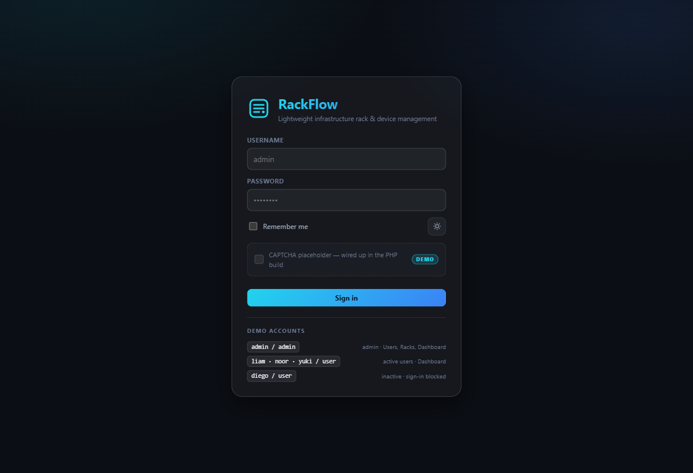
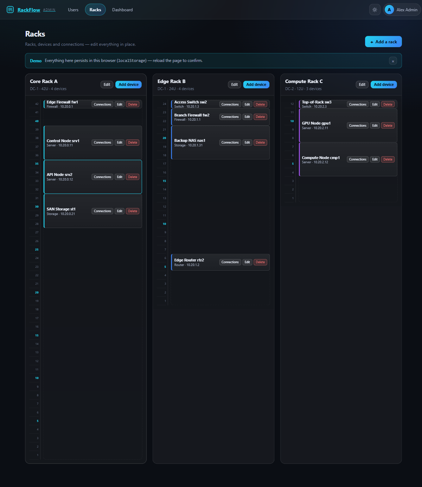
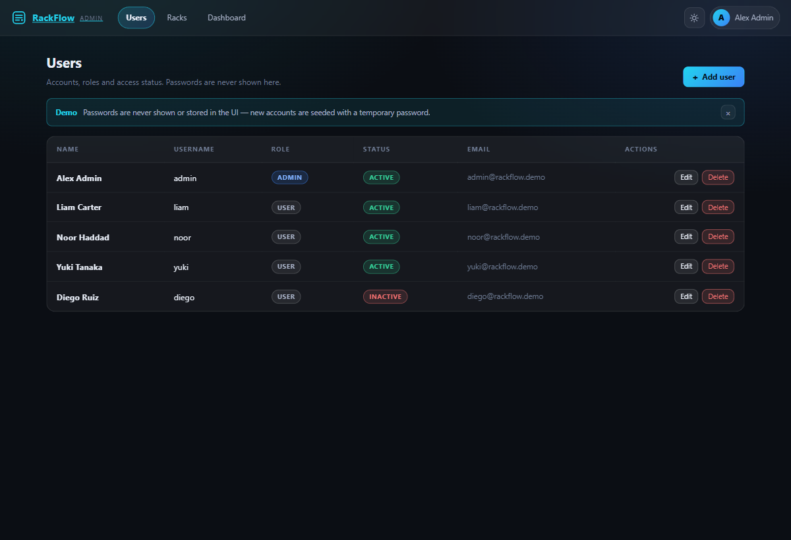
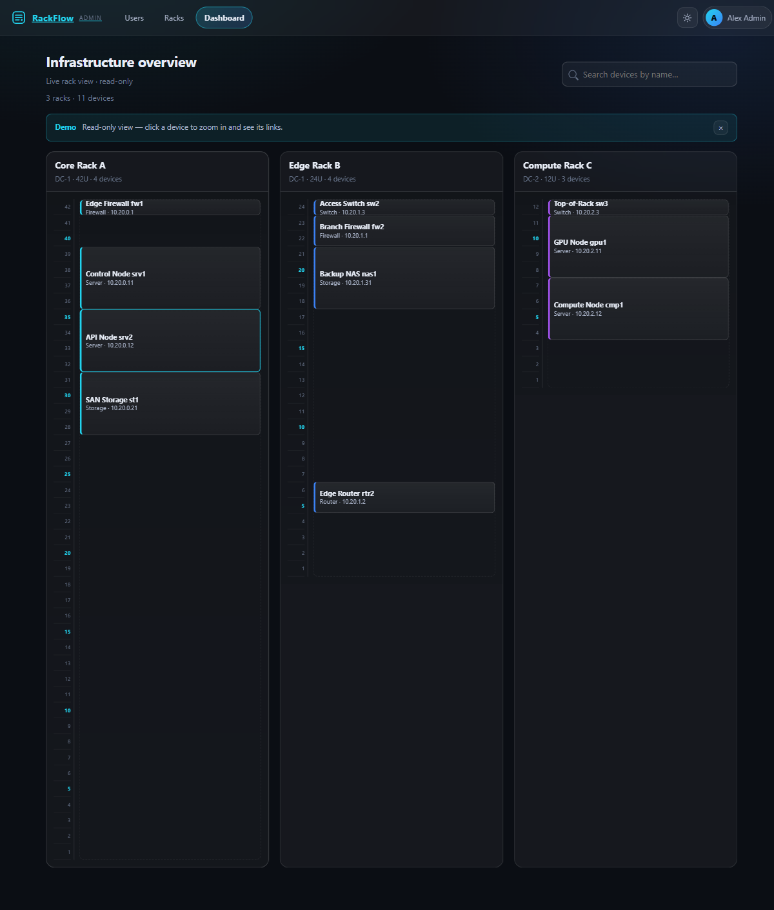

<div align="center">

# 🖥️ RackFlow

**Lightweight infrastructure rack & device management — a tiny DCIM/AMS in a browser tab.**

Vanilla HTML · CSS · JavaScript — zero frameworks, zero build step, zero runtime dependencies.

[](#)
[](#)
[](#)
[](#)



</div>

---

## ✨ Features

| Feature | What you get |
| --- | --- |
| 🗂️ **Rack management** | Create racks with a unit count (42U / 24U / 12U …), site and accent color; edit or **remove a rack with full cascade** (devices + connections) behind a confirmation modal. |
| 📦 **Device management** | Add routers, switches, firewalls, servers and storage with IP, start unit, height and named ports; validation for required names, rack bounds and unit overlaps. |
| 🔌 **Connections** | Link any device port to any other; add/remove links while the modal stays open and the rack re-renders behind it; deletes cascade automatically. |
| 🔎 **Live dashboard** | Read-only overview for users *and* admins with 120 ms-debounced search and a `N racks · M devices` count line. |
| 🔍 **Zoom view** | Click any device: full-screen rack with detailed panels (icon · name · IP) and a per-port connection list — `RJ45 1 → Core Switch cs1 → RJ45 1`. |
| 👥 **User administration** | Admin-only table (name, username, role, status, email) with add/edit/delete, role guards and **no passwords ever displayed**. |
| 🔐 **Roles & auth** | Admin sees *Users / Racks / Dashboard*; regular users see *Dashboard only*; unauthorized pages bounce to the dashboard. |
| 🎨 **Glass UI** | Dark/light theme with `backdrop-filter` glass, focus rings, accessible modals (`role="dialog"`, Esc + backdrop close) and `aria-live` toasts. |
| 💾 **Persistence** | Ships with a **real database file** (`data/rackflow-db.json`) behind the bundled server — and automatic `localStorage` fallback when served statically, so edits always survive reloads. |
| 🔌 **PHP-ready** | All data access is isolated in `Store` + `Auth` (one file), so a real API drops in behind a thin migration map (see below). |

## 📸 Screenshots

| Login | Racks (admin) |
| --- | --- |
|  |  |

| Users (admin) | Dashboard (read-only) |
| --- | --- |
|  |  |

## 🗄️ Local database (bundled server)

RackFlow ships with a tiny zero-dependency PowerShell server that doubles as a **simple database**:

```powershell
# double-click server\start.bat, or:
powershell -NoProfile -ExecutionPolicy Bypass -File server\serve.ps1 -Port 8082
```

| Endpoint | Behaviour |
| --- | --- |
| `GET /api/state` | Returns the whole database as JSON — `404` while no DB file exists yet |
| `POST /api/state` | Validates (`racks[]` + `users[]` required) and **atomically** writes `data/rackflow-db.json` |
| `GET /api/health` | `200 ok` (compose parity) |
| everything else | Served exactly like `python3 -m http.server` (SPA fallback included) |

**How the client picks its storage** (`Store` in `js/app.js`):

1. Page loads → state is read from `localStorage` instantly (no flicker).
2. `Store` probes `GET /api/state`:
   - **server up + JSON file exists** → the file DB is the source of truth and re-renders the page (`Store.ready(cb)` hooks).
   - **server up, no file yet** → current state is POSTed once to bootstrap the DB.
   - **static host / `file://` / any error** → silently stays in `localStorage` mode — nothing breaks.
3. Every mutation writes `localStorage` immediately and, in server mode, a **debounced (250 ms)** `POST /api/state`.

So: close the project, reopen it, run `server\start.bat` — your racks, devices, connections and users are still there, in one plain JSON file you can back up or diff. The `data/` folder is git-ignored (runtime data, not source).

## 🚀 Deploy Option A — Docker

```bash
# one command
docker compose -f docker/docker-compose.yml up -d --build

# or the packaged script (build + start + prints the URL)
./docker/deploy.sh
```

Then open `http://localhost:8082` (override with `RACKFLOW_PORT`).

```bash
RACKFLOW_PORT=9000 docker compose -f docker/docker-compose.yml up -d --build
```

**Good to know**

- ✅ Healthcheck probes `http://127.0.0.1/` (never `localhost` — IPv6 pitfall in Alpine images).
- ✅ `restart: unless-stopped` — the container comes back after crashes and reboots.
- 🔥 Firewall tip: only publish the port you actually need.

```bash
sudo ufw allow 8082/tcp   # example: RackFlow on 8082
sudo ufw reload
```

**Files in `docker/`**

| File | Purpose |
| --- | --- |
| `Dockerfile` | `nginx:1.27-alpine`, copies the site from the project-root build context, `EXPOSE 80` |
| `nginx.conf` | Security headers (`nosniff`, `X-Frame-Options: DENY`, referrer policy), 30-day immutable cache for static assets, SPA fallback |
| `docker-compose.yml` | Build context `..`, `container_name: rackflow`, `${RACKFLOW_PORT:-8082}:80`, healthcheck |
| `.env` | `RACKFLOW_PORT=8082` |
| `deploy.sh` | One-command build + (re)start |

> A `.dockerignore` at the project root keeps `node_modules/`, `.git/`, `docs/` and the README out of the build context.

## 🐧 Deploy Option B — plain Ubuntu (nginx)

```bash
# 1. install nginx
sudo apt update && sudo apt install -y nginx

# 2. copy the site
sudo mkdir -p /var/www/rackflow
sudo cp -r index.html users.html admin.html dashboard.html css js assets /var/www/rackflow/

# 3. site config (with caching)
sudo tee /etc/nginx/sites-available/rackflow >/dev/null <<'EOF'
server {
    listen 80;
    server_name _;
    root /var/www/rackflow;
    index index.html;

    add_header X-Content-Type-Options "nosniff" always;
    add_header X-Frame-Options "DENY" always;
    add_header Referrer-Policy "strict-origin-when-cross-origin" always;

    location ~* \.(css|js|svg|png|jpg|ico)$ {
        expires 30d;
        add_header Cache-Control "public, max-age=30d, immutable";
        try_files $uri =404;
    }
    location / { try_files $uri $uri/ /index.html; }
}
EOF

# 4. enable + reload
sudo ln -s /etc/nginx/sites-available/rackflow /etc/nginx/sites-enabled/
sudo nginx -t && sudo systemctl reload nginx
```

**No nginx at all?** Any static file server works — try
`python3 -m http.server 8082 --directory /var/www/rackflow` as a quick fallback
(works because RackFlow is plain static files; `file://` works too).

## 🔑 Demo accounts

| Username | Password | Role | Status | Access |
| --- | --- | --- | --- | --- |
| `admin` | `admin` | admin | active | Users · Racks · Dashboard |
| `liam` | `user` | user | active | Dashboard |
| `noor` | `user` | user | active | Dashboard |
| `yuki` | `user` | user | active | Dashboard |
| `diego` | `user` | user | **inactive** | sign-in is blocked |

> The CAPTCHA box on the login page is a **placeholder** (DEMO badge) — hook it up in the PHP build.
> Passwords are never rendered anywhere in the UI; the change-password flow is a UI-only mock.

## 📁 Project structure

```
index.html        login (glass card, CAPTCHA placeholder, theme toggle)
admin.html        Racks tab — racks, devices, connections   (admin only)
users.html        Users tab                                 (admin only)
dashboard.html    read-only live rack view (users AND admins)
css/style.css     design system (dark/light tokens, glass, modals, toasts)
js/app.js         shared core: Icons · Store · Auth · UI · rack renderer · zoom
js/login.js       login flow (shake-on-error, remember me)
js/admin.js       rack/device/connection CRUD
js/users.js       user CRUD + guards
js/dashboard.js   search filter + zoom entry
assets/logo.svg   static logo (also inlined as a JS sprite)
docs/screenshots/ README screenshots
docker/           Dockerfile, nginx.conf, docker-compose.yml, .env, deploy.sh
server/           serve.ps1 (static files + /api/state JSON database), start.bat
data/             rackflow-db.json — runtime database (created on first save, git-ignored)
.gitignore        keeps data/ out of version control
```

**Constraints honored:** no frameworks, no libraries, no CDN, no icon fonts, no npm, no build step,
no ES modules (works over `file://` and any plain static server); icons are an inline SVG sprite
defined in JS; every dynamic string is passed through `escapeHtml()` before `innerHTML`.

## 🔌 PHP migration map

All data access lives behind `Store` + `Auth` in `js/app.js`. Replace that layer only —
the pages and rendering stay untouched.

| Mock call in `js/app.js` | Replace with | Minimal SQL |
| --- | --- | --- |
| `Store.init()` / `Store.persist()` | `GET /api/bootstrap` (implicit on load) | — |
| `Store.racks()` · `Store.rack(id)` | `GET /api/racks` · `GET /api/racks/{id}` | `SELECT * FROM racks` |
| `Store.addRack(o)` | `POST /api/racks` | `INSERT INTO racks (name, site, units, accent) VALUES (?,?,?,?)` |
| `Store.updateRack(id,patch)` | `PUT /api/racks/{id}` | `UPDATE racks SET name=?, site=?, units=?, accent=? WHERE id=?` |
| `Store.removeRack(id)` | `DELETE /api/racks/{id}` | `DELETE FROM racks WHERE id=?` (cascade devices + links) |
| `Store.devicesIn(rackId)` · `Store.device(id)` | `GET /api/devices?rack=…` · `GET /api/devices/{id}` | `SELECT * FROM devices WHERE rack_id=?` |
| `Store.addDevice(o)` | `POST /api/devices` | `INSERT INTO devices (rack_id, kind, name, ip, start_u, height_u, ports) VALUES (?,?,?,?,?,?,?)` |
| `Store.updateDevice(id,patch)` | `PUT /api/devices/{id}` | `UPDATE devices SET … WHERE id=?` |
| `Store.removeDevice(id)` | `DELETE /api/devices/{id}` | `DELETE FROM devices WHERE id=?` (cascade links) |
| `Store.conns()` · `Store.connsFor(devId)` | `GET /api/links` · `GET /api/links?device=…` | `SELECT * FROM links` |
| `Store.addConn(a,ap,b,bp)` | `POST /api/links` | `INSERT INTO links (dev_a, port_a, dev_b, port_b) VALUES (?,?,?,?)` |
| `Store.removeConn(id)` | `DELETE /api/links/{id}` | `DELETE FROM links WHERE id=?` |
| `Store.users()` · `Store.user(id)` | `GET /api/users` | `SELECT id, name, username, email, role, status FROM users` (**never** `password`) |
| `Store.addUser(o)` | `POST /api/users` | `INSERT INTO users (…) VALUES (…)` + `password_hash()` |
| `Store.updateUser(id,patch)` | `PUT /api/users/{id}` | `UPDATE users SET name=?, username=?, email=?, role=?, status=? WHERE id=?` |
| `Store.removeUser(id)` | `DELETE /api/users/{id}` | `DELETE FROM users WHERE id=?` |
| `Auth.login(u,p)` | `POST /api/auth/login` → session cookie | `SELECT … FROM users WHERE username=?` → `password_verify()` |
| `Auth.current()` | `GET /api/auth/me` | session table / signed cookie |
| `Auth.logout()` | `POST /api/auth/logout` | destroy session |
| `Auth.require(adminOnly)` | same, server-side **must re-check the role** | — |

```sql
-- schema sketch
CREATE TABLE racks    (id VARCHAR(32) PRIMARY KEY, name VARCHAR(80), site VARCHAR(40),
                       units SMALLINT, accent CHAR(7));
CREATE TABLE devices  (id VARCHAR(32) PRIMARY KEY, rack_id VARCHAR(32) REFERENCES racks(id) ON DELETE CASCADE,
                       kind VARCHAR(20), name VARCHAR(80), ip VARCHAR(45),
                       start_u SMALLINT, height_u SMALLINT, ports TEXT);
CREATE TABLE links    (id VARCHAR(32) PRIMARY KEY,
                       dev_a VARCHAR(32), port_a VARCHAR(60),
                       dev_b VARCHAR(32), port_b VARCHAR(60));
CREATE TABLE users    (id VARCHAR(32) PRIMARY KEY, name VARCHAR(80), username VARCHAR(40) UNIQUE,
                       email VARCHAR(120), role ENUM('admin','user'), status ENUM('active','inactive'),
                       password VARCHAR(255));
```

## 📜 License

MIT — do whatever, attribution appreciated.
